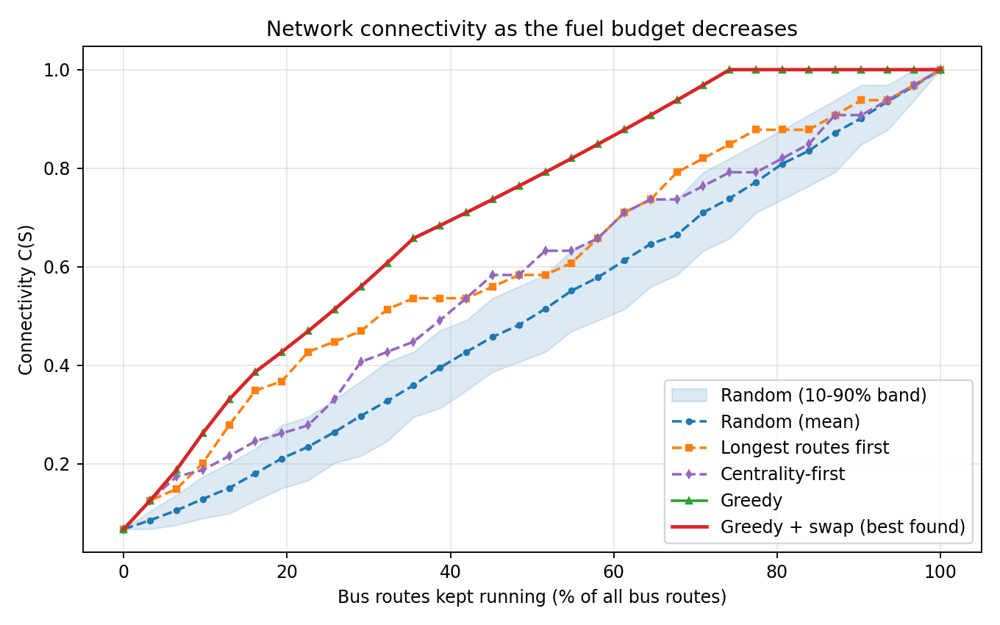
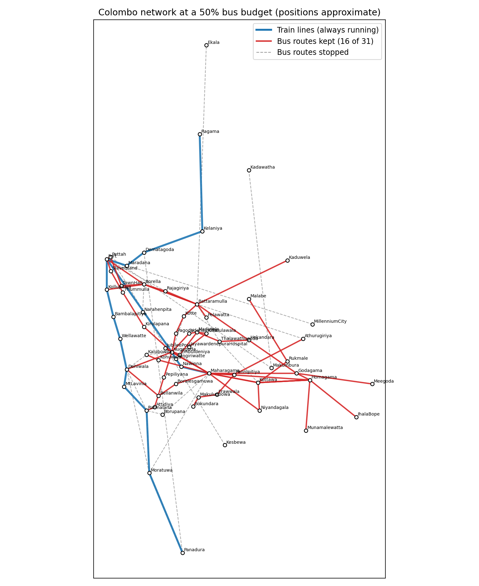

# Which Bus Routes Should Keep Running? Graph-Based Route Selection for Colombo under Fuel Shortage

A graph-theory research project on Colombo's bus–train network. When fuel shortages force bus services to be cut, **which routes should be kept so that as many places as possible stay reachable?**

Sri Lanka has faced this repeatedly: private operators reported running about a quarter of their fleet in March 2022, and operators warned of cuts of up to 50% again in March 2026. Trains kept running both times, so this project treats trains as a fixed backbone and buses as the adjustable layer.

> Course project for *Graph Theory* (BSc Honours in Data Science, Sabaragamuwa University of Sri Lanka). Full write-up: [`report/Graph_Theory_Assignment_Report.pdf`](report/Graph_Theory_Assignment_Report.pdf)

## Problem

Model the network as a graph (nodes = stops/towns, edges = consecutive stops on a route). For a set `S` of kept bus routes, connectivity is the fraction of stop pairs that can still reach each other:

```
C(S) = sum over components c of |c|(|c|-1)  /  ( n (n-1) )
```

**Budgeted Route Selection:** maximise `C(S)` subject to `|S| <= k`, with all train lines always running.

## Method

- **Data:** 64 stops, 31 bus routes, 3 train lines (Colombo metropolitan area), compiled from public sources (see `data/routes.csv` and the report).
- **Strategies compared:** random (300 trials), longest-routes-first (demand proxy), centrality-first, greedy selection, greedy + swap local search, and an exhaustive search for small budgets (k <= 7).
- **Extra analysis:** route criticality (drop-one), betweenness centrality of stops, robustness check without the endpoint-only Metro Bus routes.
- **Tools:** Python, NetworkX, Matplotlib.

## Key results

| Routes kept | Random | Longest-first | Centrality-first | Greedy |
|---|---|---|---|---|
| 25% (8 of 31) | 0.265 | 0.448 | 0.330 | **0.513** |
| 50% (16 of 31) | 0.515 | 0.583 | 0.632 | **0.792** |
| 75% (23 of 31) | 0.739 | 0.849 | 0.792 | **1.000** |

- With half the bus routes running, greedy selection keeps **79.2%** of stop pairs connected, versus 58.3% (longest-first) and 51.5% (random).
- Exhaustive search for budgets of up to 7 routes shows that **greedy is exactly optimal** there.
- Full connectivity needs only **23 of 31 routes**, so 8 routes are redundant for reachability.
- Routes **138** and **212/341** are the most critical single routes; **Nugegoda** and **Maharagama** are the most central stops.
- Conclusions hold when the endpoint-only Metro Bus routes are removed.




## Limitations

- Routes were compiled from public web pages at town level, and whether each route runs today is only partly verified. Treat the data as a snapshot, not an operational plan.
- Metro Bus (CM) routes have published endpoints only.
- Connectivity ignores demand, travel time, frequency and capacity; the budget counts routes, not fuel-kilometres.
- Greedy is verified optimal only for budgets up to 7 routes; beyond that there is no optimality proof (the objective is not submodular, see the report).
- Map positions in Figure 2 are approximate and used only for drawing.

## Run it

```bash
pip install -r requirements.txt
python bus_route_selection.py      # prints results, saves figures to figures/
python exhaustive_check.py         # optional: exhaustive check for k <= 7 (a few minutes)
```

Or open `bus_route_selection.ipynb` (outputs included).

## Repository structure

```
bus_route_selection.py      analysis + figures
exhaustive_check.py         greedy vs exhaustive optimum (k <= 7), centrality baseline
bus_route_selection.ipynb   same code as a notebook, with outputs
data/routes.csv             routes used (stops in order)
figures/                    figures used in the report
report/                     full report (PDF and DOCX)
```

## Future work

Demand-weighted objective, fuel-based budget (route length x frequency) as an integer program, travel-time and transfer measures, exact bounds on the greedy solution, verified up-to-date route data, and equity weights.

## References (selected)

1. Cicchini, Caridi & Ermann (2024). *Robustness of the public transport network against attacks on its routes.* arXiv:2409.12460
2. Guillot, Furno, Aghezzaf & El Faouzi (2022). *Transport network downsizing based on optimal sub-network.* Communications in Transportation Research, 2, 100079
3. Shao, Zhang & Li (2026). *Robustness analysis and optimization strategy of urban bus network based on complex network.* Sustainability, 18(12), 6320
4. Rajapaksha, Lanel, Athapattu & Sanjeewa (2026). *Multiplex centrality-driven analysis for enhancing urban transport resilience and infrastructure planning.* Ceylon Journal of Science, 55(4)

The complete reference list is in the report.

## License

MIT
